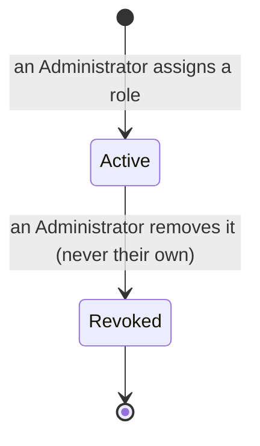

# Authentication and roles

Supporting detail for [`authentication-and-roles.feature`](authentication-and-roles.feature)
that doesn't fit Gherkin.

## Authentication boundary

Identity arrives as a signed JWT, presented as `Authorization: Bearer <jwt>`.
The API validates the signature, the issuer, the audience `hpac-safety-api`,
and the lifetime, then reads exactly two claims: the token subject and the role.
Nothing else — not a name, not an email address, not a picture
([ADR-0064](../../decisions/ADR-0064-jwt-bearer-authentication-with-three-roles.md)).

**The identity provider proves membership only.** A validated token makes its
bearer a member with the User role. Administrator and Safety Officer come only
from this application's own role assignments, or from the Super Administrator,
under every issuer ([ADR-0199](../../decisions/ADR-0199-roles-come-from-application-owned-role-assignments-and-the-provider-proves-membership-only.md), [ADR-0200](../../decisions/ADR-0200-a-permanent-super-administrator-comes-from-configuration.md)); see "Role assignments" below. There is no user
table: a role assignment holds an email, a role, and when and by whom it was
granted and revoked, and nothing else about the person. Where a report's approver or an audit entry's actor is recorded, it is
the token subject as an opaque string that joins to nothing.

The role claim's **name** is configuration; its **values** are the invariant
codes `user`, `safety_officer`, and `administrator`. A claim may be a string or
an array, and the highest role present wins; none means `User`
(`REQ-MOD-017`). A role claim never grants a reviewer's role; only a role
assignment or the Super Administrator does.

The production provider is not yet chosen — Auth0 and AWS Cognito are the
candidates, and any provider emitting the claim shape above satisfies the
contract. In development the API issues its own genuinely signed token and
validates it through the same middleware, so only the issuer and the key differ
([ADR-0066](../../decisions/ADR-0066-a-development-identity-provider-signed-with-a-dev-key.md)).
Development may also sign a real member in by checking their password against
the live members site, for that one call only
([ADR-0079](../../decisions/ADR-0079-a-development-login-may-verify-against-the-live-members-site.md)).
The third-party sign-in option is production-only; the browser learns whether
to offer it from `GET /api/auth/config`, never from a build flag.

A bearer token carries no ambient authority, so state-changing admin requests
need no CSRF protection.

**No identity provider configured is a stated limitation, not a startup
failure.** Outside Development, until `HpacSafety:Authentication:Authority`
is set for an environment, that environment still starts and serves its
public endpoints — `/health`, public questions, the public feed and
submission — but no bearer token can ever validate: sign-in, review, and
administration cannot work there
([ADR-0158](../../decisions/ADR-0158-two-aws-accounts-staged-and-promoted-by-approval.md)).
The host logs one warning at startup and registers a bearer scheme with no
authority, no signing keys, and an issuer no real token will ever carry, so
every authorization-protected endpoint refuses every token with 401
(REQ-MOD-156, REQ-AUTH-008). A configured Authority keeps today's behavior exactly.

**Staging is a temporary exception.** Behind
`HpacSafety:Authentication:InterimIssuer:Enabled` — never set alongside an
`Authority`, and never in Development or production — this API becomes its
own small RS256 identity provider: `GET /api/auth/interim/.well-known/openid-configuration`
and `GET /api/auth/interim/jwks` are mapped alongside `POST /api/auth/token`,
which reuses Development's own members-site credential check (ADR-0079) and
takes the role from role assignments ([ADR-0199](../../decisions/ADR-0199-roles-come-from-application-owned-role-assignments-and-the-provider-proves-membership-only.md)) — **`FixedAccountCredentialSource` is not
registered here**, so the fixed development accounts
(`admin`/`admin`, `officer`/`officer`, `user`/`user`) do not exist outside
Development; only a real members-site sign-in signs a member in on staging.
Validation is pinned in-process to this host's own key and issuer,
`urn:hpac-safety:interim-issuer` — no metadata fetch, same as Development.
With the flag off, none of these three routes exist (404, not 401)
(REQ-MOD-157, REQ-AUTH-009, REQ-MOD-158, REQ-AUTH-010, REQ-AUTH-011, REQ-MOD-159). Every part of this is deleted once a
real identity provider is chosen
([ADR-0172](../../decisions/ADR-0172-a-temporary-interim-issuer-signs-staging-tokens-until-a-real-provider-exists.md)).
Role assignments, the Super Administrator, and the manage-roles page are
permanent and are not part of that deletion.

## Roles

| Role | Capabilities |
|---|---|
| User | Proves HPAC membership. May submit an occurrence report. Nothing else — no review, authoring, or publication capability. |
| Safety Officer | View the report list and private report material; view safe image/video derivatives and download validated unredacted documents; edit the bilingual summary pair; publish, unpublish, and delete reports; keep private notes on a report ([ADR-0133](../../decisions/ADR-0133-staff-keep-private-notes-on-a-report.md)); add, download, and remove a report's private attachments ([ADR-0135](../../decisions/ADR-0135-staff-add-private-attachments-to-a-report.md)); review type-ahead values (approve, correct, merge, remove) ([ADR-0129](../../decisions/ADR-0129-a-type-ahead-value-is-edited-in-place-merged-and-reviewed.md)). |
| Administrator | Every Safety Officer capability, plus create question revisions and author each question's choices, including fixing or replacing a picker choice ([ADR-0128](../../decisions/ADR-0128-an-answer-names-its-choice-and-a-picker-option-is-fixed-or-replaced.md)). |

Submission is a membership capability rather than a privileged one, so any of
the three roles may file a report — and the report records nothing about who
did ([ADR-0067](../../decisions/ADR-0067-a-reporter-must-be-a-member-and-is-not-recorded.md)).

`Administrator` is not a superuser (`REQ-MOD-035`).

## Role assignments

A role assignment gives one email address one of two roles: Administrator, or
Safety Officer ([ADR-0199](../../decisions/ADR-0199-roles-come-from-application-owned-role-assignments-and-the-provider-proves-membership-only.md)). An Administrator lists, adds, and removes them on the
manage-roles page. Nobody else may open that page or ask for its data
(REQ-AUTH-019, REQ-AUTH-020).

| Part | Holds |
|---|---|
| Email address | The address the member signs in with, stored normalised: trimmed and lower-cased. Every lookup, duplicate check, and removal compares that form, so case and surrounding spaces never matter (REQ-AUTH-028). It need not be registered on the members site yet, and adding it raises no warning. |
| Role | Administrator, or Safety Officer. |
| Granted at | The time it was assigned. |
| Granted by | The token subject of the Administrator who assigned it. |
| Revoked at | Empty while active; the time it was removed. |
| Revoked by | Empty while active; the token subject of the Administrator who removed it. |

Nothing else about the person is held: no name, no profile. Under staging's
interim issuer a token subject is `member:<email>`, so "Granted by", "Revoked
by", and an audit entry's actor can hold an Administrator's email; it is
stored, never logged (CON-IF-011).

**An email address is ASCII** ([ADR-0199](../../decisions/ADR-0199-roles-come-from-application-owned-role-assignments-and-the-provider-proves-membership-only.md)). Assigning one with any non-ASCII
character is refused (REQ-AUTH-031), and a sign-in name with any non-ASCII
character never matches an assignment (REQ-AUTH-032). Lower-casing turns some
non-ASCII characters into ASCII ones, such as the Kelvin sign (U+212A) into
`k`; without this, a look-alike name could match another member's
assignment.

- **Removal is a revoke.** The row stays, marked with when and by whom
  (REQ-AUTH-014). The database refuses a delete, and any update but that one
  revoke of an active assignment (CON-DP-017). Adding the same address again
  creates a new assignment.
- **No Administrator removes their own assignment** (REQ-AUTH-015).
- **One active assignment per address, in any role** (REQ-AUTH-016). To
  change a member's role, remove the assignment and add it again.
- **Every request re-checks.** A request that needs a reviewer or an
  Administrator resolves the role from the member's active assignment at that
  moment, so a removal takes effect on the member's next request, whatever
  token they hold (REQ-AUTH-021): a Safety Officer loses reviewer access, an
  Administrator loses Administrator access. A member with a new assignment
  signs in with that role and its access (REQ-AUTH-022).
- **Unreadable means User.** When role assignments cannot be read, a member
  resolves to User (REQ-AUTH-023). The manage-roles page then lists the Super
  Administrator, says plainly that the other assignments cannot be shown right
  now, and offers no adding or removing until they can (REQ-AUTH-029).
- **Development only** also takes roles from its fixed accounts and its
  members-site email lists, checked alongside role assignments on every
  request (REQ-MOD-020,
  [ADR-0079](../../decisions/ADR-0079-a-development-login-may-verify-against-the-live-members-site.md)).
  No other environment has either.
- **Every add and remove is audited**, by the acting token subject, naming
  the role assignment as its target and never the email address
  (REQ-AUTH-030), and without the email address in any log (CON-IF-011).

### The Super Administrator

One email address per environment, read from configuration and never from the
database ([ADR-0200](../../decisions/ADR-0200-a-permanent-super-administrator-comes-from-configuration.md)). Its value is held in a masked environment secret, `SUPER_ADMIN`,
and appears in no committed file, log, or plan comment (CON-INF-028).

- It always resolves to Administrator, also when role assignments cannot be
  read (REQ-AUTH-024).
- Its value lives in Secrets Manager, reached by ARN; the deploy fills it from
  the `SUPER_ADMIN` environment secret where that is set (CON-INF-028).
- The manage-roles page always lists it as a permanent Administrator with no
  removal, also when role assignments cannot be read (REQ-AUTH-017,
  REQ-AUTH-018).
- A blank value means there is none. Where `SUPER_ADMIN` is unset, the
  deploy blanks the stored value, so removing the secret retires the Super
  Administrator at the next deploy (CON-INF-028). This change sets it for staging only.
- Under a real identity provider, mapping it is #911's (REQ-AUTH-025).

## Pending counts on the Admin menu (#418)

The Admin menu shows how much work is waiting, so a reviewer sees it without
opening each page. **Manage reports** carries the number of reports the
*Needs action* filter lists, and **Type-ahead values to review** carries the
number awaiting review on the type-ahead review page. The closed **Admin** button carries the total of the
counts the member can see (REQ-MOD-087, REQ-MOD-093; each item's own count:
REQ-AUTH-005, REQ-AUTH-006). A count of zero shows no badge (REQ-MOD-089,
REQ-AUTH-007). The badge is a
filled brand-red pill ([design system](../../../docs/design-system.md)).

`GET /api/admin/counts` answers any reviewer, and carries no report content,
so it is not audited. It still gives an Administrator the number of answers
waiting for the Worker's automatic translation
([REQ-MOD-084..086](../admin-report-search/admin-report-search.feature)), an
operational signal only — there is no page or nav item to act on it, since
nothing but the Worker ever fills that second language (ADR-0174). The counts
are read from the same database views as the two lists, so they
cannot disagree with them. The menu refetches on each navigation.

## Out of scope

What not to build here. The global list in
[system overview](../../system-overview.md) still holds; this narrows it
to this area ([ADR-0083](../../decisions/ADR-0083-specification-driven-development.md)).

- A live-updating or polling count on the Admin menu. The counts refresh when
  the member navigates.
- A count on Manage questions, or a per-status breakdown of the reports
  needing action.
- A user table or a session store. A role assignment is an email, a role, and its
  record of who granted and revoked it and when, not a member record ([ADR-0199](../../decisions/ADR-0199-roles-come-from-application-owned-role-assignments-and-the-provider-proves-membership-only.md)).
- A name, a profile, or any other detail about the person on a role
  assignment ([ADR-0199](../../decisions/ADR-0199-roles-come-from-application-owned-role-assignments-and-the-provider-proves-membership-only.md)).
- An invitation, or any email sent when a role is assigned or removed. The
  application sends no email (CON-INF-002).
- A bulk import or export of role assignments. They are added one at a time
  on the manage-roles page (#909).
- A warning that an address is not yet registered on the members site (#909).
- Removing, editing, or adding the Super Administrator on the manage-roles
  page; it changes only with its configuration ([ADR-0200](../../decisions/ADR-0200-a-permanent-super-administrator-comes-from-configuration.md)).
- Taking a role from an identity provider's claims, under any issuer ([ADR-0199](../../decisions/ADR-0199-roles-come-from-application-owned-role-assignments-and-the-provider-proves-membership-only.md)).
- Physically deleting a role assignment, or restoring a revoked one; adding
  the address again creates a new one ([ADR-0199](../../decisions/ADR-0199-roles-come-from-application-owned-role-assignments-and-the-provider-proves-membership-only.md)).
- Handling a member's password, outside Development's carve-out and its
  temporary staging extension
  ([ADR-0079](../../decisions/ADR-0079-a-development-login-may-verify-against-the-live-members-site.md),
  [ADR-0172](../../decisions/ADR-0172-a-temporary-interim-issuer-signs-staging-tokens-until-a-real-provider-exists.md)).
- CSRF machinery or Turnstile. A bearer token carries no ambient authority
  ([ADR-0068](../../decisions/ADR-0068-the-member-token-replaces-turnstile-on-submission.md)).
- A per-reporter rate limit, which would mean identifying the reporter.
